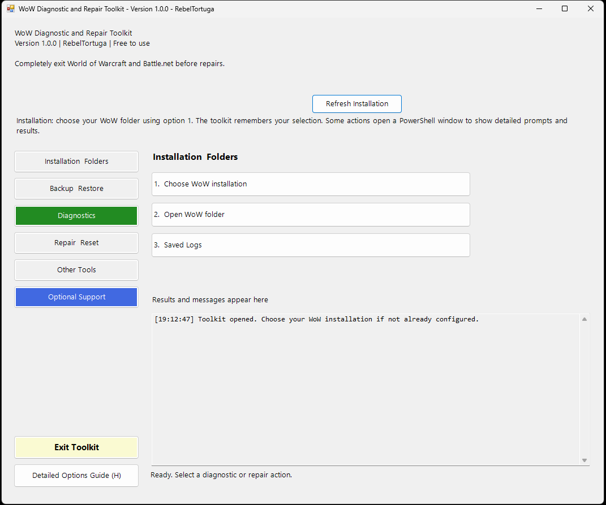

# WoW Diagnostic and Repair Toolkit
**Developer:** RebelTortuga  
**Platform:** Windows 10 / Windows 11  
**Cost:** Free to use. No payment is ever required.

**A note from RebelTortuga:** This is the first toolkit I’ve ever created. After years of troubleshooting World of Warcraft, reading Blizzard Support guidance and blue posts, and learning from other players, I wanted to build something I hadn’t found in the other toolkits I’d tried: a single place to **diagnose potential problems and choose repairs**. Instead of jumping straight into cleanup or resets, you can run read-only diagnostics, review what stands out, and decide what—if anything—to fix. I’m sharing it free with the WoW community, and suggestions, new feature ideas, and constructive feedback are always welcome.

An independent WoW troubleshooting toolkit. Some procedures follow official Blizzard Support recommendations and guidance published in Blizzard blue posts. **This is not an official Blizzard product.** Provided as is; use at your own risk.

## Screenshot

## Start here
1. Extract the entire ZIP into one folder. Do not run it inside the ZIP.
2. Double-click **`WoW Diagnostic and Repair Toolkit.bat`**.
3. A PowerShell launcher may appear briefly; the **graphical toolkit remains open**.
4. Select a category in the left sidebar and click an action on the right.
5. Choose **Installation & Folders → 1. Choose WoW installation** if you have not selected your installation. Click **Refresh Installation** after completing the selection.
6. Use **Detailed Options Guide (H)** for full descriptions, and **Exit Toolkit** to close the graphical window.

**Important:** The GUI is modeled on the Firefox Toolkit v1.0.0, but existing WoW operations still use interactive PowerShell prompts. Clicking an action opens its own PowerShell console for the original workflow; complete its prompts there. The graphical toolkit remains open. **Some operations request administrator approval.** The GUI itself does not require administrator approval at startup.

**Before repairs, completely exit WoW and Battle.net**, including the Battle.net system-tray icon. Do not just minimize them.

## Requirements
- Windows 10/11, Windows PowerShell **5.1** (built into Windows), Windows Forms and Windows Script Host (usually included with Windows).
- PowerShell 7, Python, Git and third-party PowerShell modules are **not required**.
- Administrator permission for the original repair engine when prompted.
- Keep the **BAT, VBS, both toolkit PS1 scripts, diagnostic PS1 script and Markdown guides together**.
- Windows security settings can block downloaded scripts. Review the source and follow your organization's security policy. The launcher uses a process-only execution-policy bypass, not a permanent policy change.

## Graphical interface
The main window follows the Firefox Toolkit's sidebar organization. **Diagnostics** has a green button, **Optional Support** has a blue button, and **Installation & Folders**, **Backup & Restore**, **Repair & Reset**, and **Other Tools** use the standard button color:

- **Installation & Folders** — options 1–3.
- **Backup & Restore** — options 4–5.
- **Diagnostics** — option 6, quick/full scans and report export.
- **Repair & Reset** — options 7–11.
- **Other Tools** — options 12–14.
- **Detailed Options Guide (H)** — opens `OPTIONS-README.md`.
- **Exit Toolkit** — closes the GUI, not a separate repair window already running.

The results area records which actions were launched. **Detailed diagnostic findings, repair progress and interactive confirmations appear in the action's PowerShell window**, not in the GUI results box. Repair logging remains available under `%LOCALAPPDATA%\RebelTortuga\WoW-Toolkit\Logs`.

## Main menu at a glance
The graphical sidebar lists the sections in order, with numbered actions displayed in the panel to the right. **Optional Support** follows **Other Tools**. **Exit Toolkit** and **Detailed Options Guide (H)** are separate sidebar controls.

| Section | Option | Action |
| --- | --- | --- |
| Installation & Folders | **1** | Choose WoW installation |
| Installation & Folders | **2** | Open WoW folder |
| Installation & Folders | **3** | Saved Logs |
| Backup & Restore | **4** | Save a backup |
| Backup & Restore | **5** | Restore a backup |
| Diagnostics | **6** | Diagnostics Center (read-only) |
| Repair & Reset | **7** | Clear Battle.net files |
| Repair & Reset | **8** | Reset AddOns and settings |
| Repair & Reset | **9** | Clear WDB cache |
| Repair & Reset | **10** | Rebuild game indexes |
| Repair & Reset | **11** | Comprehensive repair |
| Other Tools | **12** | Copy DirectX 11 argument |
| Other Tools | **13** | Enable admin requirement |
| Other Tools | **14** | Remove admin requirement |
| Optional Support | **15** | Optional Ko-fi support (opens with confirmation) |
| Navigation | **H** | Open detailed options guide |
| Navigation | — | Exit Toolkit |

For **what each action changes, limitations, and precautions**, see **[OPTIONS-README.md](OPTIONS-README.md)**. The toolkit also shows a short explanation when you select a numbered option. Some file-changing options require an additional confirmation.

## Safety before repairs
**Diagnostics (option 6) never automatically perform repairs.** Start there if you are unsure which action is appropriate.

You do **not** need to run every repair for routine troubleshooting. A deliberate, broader refresh can be appropriate instead of reinstalling, but each action has consequences:

- Back up important `Interface`, `WTF`, and `Screenshots` data **outside** the live WoW installation.
- **Completely exit WoW and Battle.net** when instructed before a repair. Do not merely minimize their windows: exit the game and quit Battle.net from the system tray as well. Confirm neither is still running before proceeding.
- **Option 7** removes selected launcher support-data folders from Windows application-data and temporary locations; this is more than clearing a simple cache.
- **Option 8** makes a verified backup of `Interface`/`WTF` and renames `Interface`, `WTF`, and `Cache` so WoW can recreate them.
- **Option 10** removes selected game index files, not large `data.###` archives; the launcher may need to rebuild or download files.
- **Option 11** combines launcher support-data cleanup and a WoW interface/settings reset. It does **not** run every numbered option or reinstall the game. Completed cleanup steps may not be reversible.

Read the on-screen prompts. No procedure guarantees a fix.

## Diagnostics and reports
**6 — Diagnostics Center** offers a quick health check, full scan, and report export. Checks cover local WoW folders, executable, disk space, running processes, AddOn structure and configuration. A full scan adds checks such as cache size, log filenames, graphics adapters, a limited sample of Windows Application errors, and Battle.net DNS resolution.

Results use **PASS / WARN / FAIL / INFO / UNKNOWN** and include a plain-language summary and **What stands out** observations. You can export readable **TXT and Markdown** reports to a location you select (Desktop, Documents, Downloads, folder picker, or entered path). Exporting is optional; reports are **not automatically saved in AppData**. Findings are indicators, not guaranteed diagnoses. Review exported reports before sharing.

## Installation settings and saved logs
After you choose a valid installation, the toolkit remembers the root, version and executable name in:

`%LOCALAPPDATA%\RebelTortuga\WoW-Toolkit\settings.json`

It validates the saved executable at startup. Use **option 4** to change installations. Settings belong to the Windows account under which the elevated script runs.

The main screen shows **Saved Log Path:** followed by the **current session's full repair-log filename**. Logs are kept in:

`%LOCALAPPDATA%\RebelTortuga\WoW-Toolkit\Logs`

Use **option 6 — Saved Logs** to open that folder in File Explorer. This is **different** from the destination you choose when exporting diagnostic reports. Log paths may contain identifying local information; redact them before sharing.

## Documentation and help
- **`README.md`** — installation, requirements, menu overview, safety and file locations.
- **`OPTIONS-README.md`** — detailed explanations of every numbered option and the **H** shortcut.
- **`CHANGELOG.md`** — initial public release information.

**Press H and Enter** from the main menu to open the options guide. The toolkit opens the guide in Notepad so it works even when Markdown files have no default application. This is a **keyboard shortcut**, not a clickable console link.

## Optional support
**15 — Optional Ko-fi support** is separate from troubleshooting. It asks permission before opening your browser; **all features remain free**.

## Feedback and suggestions
For bug reports, improvements, and feature requests, use the project’s GitHub Issues page when the repository is published.

## Frequently asked questions and troubleshooting

**Does this automatically repair World of Warcraft?** No. Start with the diagnostic options, inspect the report, then choose any repair deliberately. Some actions open a separate PowerShell console and may ask for administrator approval.

**The game installation is not found. What should I do?** Open **Installation & Folders**, choose the correct WoW installation, then select **Refresh Installation**. If multiple copies exist, confirm that you chose the one you actually launch.

**Why did a console window open?** The graphical menu launches existing interactive PowerShell operations in their own windows. Follow the instructions in that console; the graphical menu remains open.

**Should WoW or Battle.net be running?** No. Fully exit both programs, including Battle.net in the system tray, before repair or reset operations.

**A downloaded script is blocked. Is it safe to disable Windows security?** Do not disable system-wide protection. Read the supplied scripts and `RUN-README.md`, and follow Windows or organizational security policy. Report an unexpected warning with the exact text in a GitHub issue.

## 🔗 Related Free RebelTortuga Projects

Explore other free tools and workflows:

- [firefox-diagnostic-and-repair-toolkit](https://github.com/RebelTortuga/firefox-diagnostic-and-repair-toolkit)
- [brave-diagnostic-and-repair-toolkit](https://github.com/RebelTortuga/brave-diagnostic-and-repair-toolkit)
- [shell-diagnostic-and-repair-toolkit](https://github.com/RebelTortuga/shell-diagnostic-and-repair-toolkit)

[Browse all RebelTortuga projects](https://github.com/RebelTortuga)

## 🐢 Support RebelTortuga

All features are free. A donation is never required and does not unlock anything.

**[☕ Help this turtle get a new shell on Ko-fi!](https://ko-fi.com/rebeltortuga)**

The in-app **Optional Support** button asks before opening the same page in your browser. The toolkit does not collect payment information.

## License

MIT; see [LICENSE](LICENSE). This independent toolkit is not affiliated with Blizzard.

---

<!-- BEGIN REBELTORTUGA SAFETY -->
## Privacy & Software Safety

Read the [project safety guidance](SAFETY.md) before use. It covers permissions, backups, recovery, local files, and security warnings. See [SECURITY.md](SECURITY.md) for vulnerability reporting and the [license](LICENSE) for terms.

[Privacy & Software Safety](https://rebeltortuga.github.io/privacy-software-safety.html) · [Project Licenses](https://rebeltortuga.github.io/project-licenses.html)

Do not upload passwords, access tokens, browser profiles, private backups, or unredacted diagnostic reports to public issues.
<!-- END REBELTORTUGA SAFETY -->

<!-- rebeltortuga-official-links:start -->
## Official RebelTortuga links

- 🌐 [Website](https://rebeltortuga.github.io/)
-  [GitHub](https://github.com/RebelTortuga)
-  [Twitch](https://www.twitch.tv/rebeltortuga)
-  [YouTube](https://www.youtube.com/channel/UCpMIirV8w5RfVd9TpKpA2pQ)
-  [Patreon](https://www.patreon.com/cw/RebelTortuga)
-  [Ko-fi](https://ko-fi.com/rebeltortuga)
<!-- rebeltortuga-official-links:end -->

## Official Project Guide

[View the wow-diagnostic-and-repair-toolkit project guide](https://rebeltortuga.github.io/projects/wow-diagnostic-and-repair-toolkit.html)
